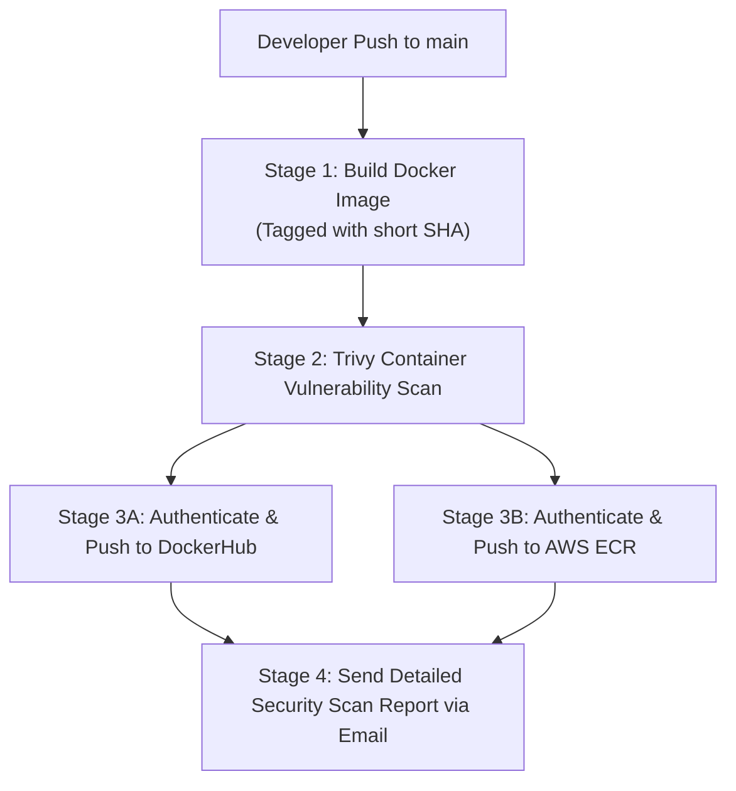

# 🚀 GitHub Actions Multi-Registry Docker DevSecOps Pipeline

<p align="center">
  <a href="https://github.com/codewithmuh/docker-ci-cd-github-actions/releases"></a>
  <a href="https://github.com/codewithmuh/docker-ci-cd-github-actions/stargazers"></a>
  <a href="https://github.com/codewithmuh/docker-ci-cd-github-actions/network/members"></a>
  <a href="LICENSE"></a>
  <a href="https://youtube.com/@codewithmuh"></a>
  <br>
  
  
  
  
</p>

A production-grade CI/CD pipeline using **GitHub Actions** for building Docker images, pushing concurrently to **DockerHub** and **AWS ECR**, scanning with **Trivy**, and sending email notifications with vulnerability reports.



---

## 🔧 Features

* ✅ Build Docker images on every push to `main`
* 🔁 Push to both **DockerHub** and **AWS ECR**
* 🛡️ Scan images for vulnerabilities using **Trivy**
* 📧 Email detailed scan reports automatically

---

## 🗂️ Repository Structure

```
.
├── .github/workflows/
│   └── docker-multi-registry.yml   # Main GitHub Actions workflow
├── Dockerfile                      # Simple Python Flask app image
├── app.py                          # Flask app code
└── README.md                       # You're here
```

---

## 🚀 Quick Start

### 1. Setup GitHub Secrets

| Name                    | Description                         |
| ----------------------- | ----------------------------------- |
| `DOCKER_USERNAME`       | DockerHub username                  |
| `DOCKER_PASSWORD`       | DockerHub password or token         |
| `AWS_ACCESS_KEY_ID`     | AWS IAM access key                  |
| `AWS_SECRET_ACCESS_KEY` | AWS IAM secret key                  |
| `AWS_REGION`            | Your AWS region (e.g., `us-east-1`) |
| `AWS_ACCOUNT_ID`        | Your AWS account ID                 |
| `EMAIL_USER`            | SMTP username (e.g., Gmail)         |
| `EMAIL_PASS`            | SMTP password / App password        |
| `EMAIL_TO`              | Recipient email address             |

---

### 2. Clone & Push Code

```bash
git clone https://github.com/codewithmuh/docker-ci-cd-github-actions
cd docker-ci-cd-github-actions
git push origin main
```

---

## ⚙️ How It Works

1. **Docker Image Build**
   On push to `main`, the image is built and tagged using the commit SHA.

2. **Push to Registries**
   Image is pushed to DockerHub and AWS ECR using configured secrets.

3. **Security Scan**
   The same image is pulled and scanned using [Trivy](https://github.com/aquasecurity/trivy).

4. **Email Notification**
   Scan report is sent as an attachment to the configured email recipient.

---

## 📬 Example Email Report

You will receive an email like:

> **Subject:** Docker Image Scan Report
> **Attachment:** `trivy-report.json`
> **Body:** The Trivy scan report is attached.

---

## ✅ Future Enhancements

* Store scan reports to **Amazon S3**
* Slack/Discord integrations
* Scheduled nightly or weekly scans
* Add **Grype**, **Dockle**, or **Snyk** for advanced analysis

---

## 📄 License

This project is open-source and available under the [MIT License](LICENSE).

---

## 🙌 Contributions

Contributions are welcome! Open an issue or submit a PR with your improvements.

---

## 💡 Author

Made with ❤️ by [CodeWithMuh](https://github.com/codewithmuh)
